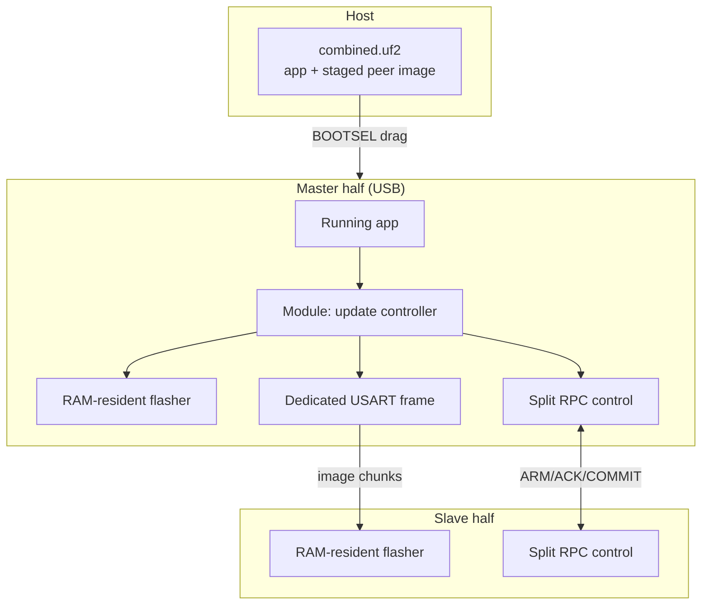

# Split Flash-From-One-Side Plan (boot2-CRC fail-safe)

> **For agentic workers:** This is a full implementation plan, not code. Do not start coding until the "Open Decisions" section is resolved. When implementation starts, work the tasks in order; each task has its own verification. The whole point of this feature is that a mistake can brick a half, so every task must be verifiable on real hardware before the next begins.

**Goal:** From the master (USB) half, update **both** halves of an RP2040 split keyboard at once, with a fail-safe that guarantees an interrupted update lands each half in a recoverable state (BOOTSEL / `RPI-RP2` mass-storage) instead of a brick.

**Architecture:** A QMK community module (`bk_split_flash`) living in the external userspace, with **no edits to `bastardkb-qmk`**. The fail-safe is the RP2040 ROM's second-stage-bootloader (boot2) CRC check. The module *arms* the fail-safe (invalidates the boot2 CRC), performs the risky copy, then *commits* (rewrites a valid boot2 last). Control is a split-transaction RPC; bulk image data moves over a dedicated frame on the existing USART link (or, in the first phase, is compiled into the module).

**Tech Stack:** QMK external-userspace community module; RP2040 ROM + pico-sdk flash/bootrom APIs already linked by the platform; `WEAR_LEVELING_RP2040_FLASH` for the reserved EEPROM region; split-transaction RPC; `util/uf2conv.py` for packaging.

**Status:** Implemented. **Parts 1–5 are complete and HW-verified** (T5.1/T5.2 on
the dilemma 4x6 procyon, with a few non-timed master cases assumed). **Part 6 (host
flashing) is deferred and not started** (user, 2026-11-11; a partial attempt was
reverted); work resumes at **Part 7** (bulk USART transport). Progress and
the resume point live in the task breakdown
`docs/superpowers/plans/2026-11-11-split-flash-both-halves-parts.md` — read its
"WHERE WE ARE" block first; it is the source of truth.

---

## 1. Why this works (the mechanism, verified)

The RP2040 ROM boots by loading a 256-byte **boot2** block from flash offset `0x0000`, computing a CRC32 over bytes `[0..251]`, and comparing it to the little-endian word at offset `0xFC`. On mismatch the ROM gives up and falls through to `_usb_boot()` → the `RPI-RP2` BOOTSEL drive. This is **sticky across power cycles**, unlike RAM-magic double-tap or `reset_usb_boot()`.

Evidence in this repo:
- boot2 is exactly 256 bytes, last 4 bytes are the checksum: `platforms/chibios/vendors/RP/stage2_bootloaders.c` (`BOOT2_ROM[256]`, e.g. ends `...0xc0, 0xdd, 0xc0, 0xb5`).
- CRC algorithm/tooling: `lib/pico-sdk/src/rp2_common/boot_stage2/pad_checksum` (bit-reversed CRC32, seed `0xffffffff`, stored little-endian).
- Vectors sit at offset `0x100` (256-aligned), so **only `0xFC`–`0xFF` is the CRC** and everything else in sector 0 is code/data: `lib/chibios-contrib/.../RP2040_rules_code_with_boot2.ld:21` (`.vectors : ALIGN(256)`).
- Flash program granularity is 256 B (`FLASH_PAGE_SIZE`), erase granularity 4096 B (`FLASH_SECTOR_SIZE`); erase count must be a multiple of 4096, program count a multiple of 256, and offsets aligned: `lib/pico-sdk/src/rp2_common/hardware_flash/include/hardware/flash.h:42,43,57,58,65,67`.
- Bootloader entry helper: `platforms/chibios/bootloaders/rp2040.c:19` (`bootloader_jump()` → `reset_usb_boot()`).

**Arming is safe to do from a running app:** writing zeros over `0xFC`–`0xFF` is a bit-subset program (no erase needed), and it leaves boot2 code (`0x00`–`0xFB`) and the vector table (`0x100`+) untouched, so the executing firmware keeps running.

**The one hard consequence:** restoring a valid CRC later requires an **erase of sector 0**, which wipes `0x00`–`0xFFF` (boot2 + vectors + the first ~3.8 KiB of app). Therefore **commit must reprogram the whole first 4 KiB sector** from a copy held in RAM, and must run from RAM with XIP off. This drives the design below.

---

## 2. Target hardware and flash layout

Applies to the BastardKB splinktegrated RP2040 boards in `qmk_userspace_private` (skeletyl, scylla, tbkmini, charybdis, dilemma). Split link is USART full-duplex (`keyboards/bastardkb/skeletyl/splinktegrated_rev3/config.h`: `SERIAL_USART_FULL_DUPLEX`, `SERIAL_USART_TX_PIN GP1`, `RX_PIN GP12`, `PIN_SWAP`).

Flash map (XIP base `0x10000000`):

| Region | Offset | Notes |
|---|---|---|
| boot2 + vectors + app head | `0x0000`–`0x0FFF` | Sector 0. Contains the CRC at `0xFC`. **Commit rewrites this whole sector.** |
| App (text/rodata/data LMA) | `0x1000`–`__flash_binary_end` | Written by COPY. |
| **Staging region** (proposed) | `__flash_binary_end` → EEPROM base | Holds the new image for the *other* half; runtime-computed, sector-aligned. |
| Reserved EEPROM (wear-leveling) | `WEAR_LEVELING_RP2040_FLASH_BASE` → top | `wear_leveling_rp2040_flash_config.h:31`. |

**Open fact to confirm in Task 0:** actual flash size and the effective `WEAR_LEVELING_BACKING_SIZE`. The linker defaults to 2048k (`RP2040_FLASH_TIMECRIT.ld:23`), and wear-leveling defaults to 8 KiB (`wear_leveling_rp2040_flash_config.h:16`), **but** the `argos` module overrides it to 256 KiB (`modules/bastardkb/argos/config.h:43-44`: `LOGICAL_SIZE 65536`, `BACKING_SIZE = LOGICAL*4`). So on argos builds the top **256 KiB** is reserved and the staging region is that much smaller. The plan must compute region bounds at runtime from linker symbols and bounds-check against `WEAR_LEVELING_RP2040_FLASH_BASE`, not hard-code them.

---

## 3. What a module can and cannot inject (verified)

Community-module mechanics (`docs/features/community_modules.md`; generator `lib/python/qmk/cli/generate/community_modules.py`):

- Auto-added `<module>.c` (filename must equal dir name), plus `rules.mk`/`post_rules.mk` for `SRC +=`, and a global `config.h`.
- Lifecycle hooks: `keyboard_pre_init_<m>`, `keyboard_post_init_<m>`, `housekeeping_task_<m>`, `process_record_<m>`, `shutdown_<m>`, etc.
- **Split RPC**: defining `SPLIT_TRANSACTION_IDS_MODULE_<MODULE>` auto-defines `SPLIT_TRANSACTION_RPC` via generated `community_post_config.h` (`community_modules.py:362-367`) and injects the enum id (`:556-561`). Then `transaction_register_rpc()` / `transaction_rpc_exec()` work (`quantum/split_common/transactions.h:48-52`).
- **Module EEPROM datablock**: `EECONFIG_MODULE_<MODULE>_DATA_SIZE` auto-wires `eeconfig_read/update_<m>_datablock()`.
- **RP2040 flash/bootrom APIs are already reachable**: `platforms/chibios/vendors/RP/RP2040.mk` adds `hardware_flash/include` and `pico_bootrom/include` to `EXTRAINCDIRS` (`:36-58`) and links `flash.c`/`bootrom.c` (`:29,34`). A module `.c` can `#include "hardware/flash.h"`, `"pico/bootrom.h"`, `"pico/platform.h"`.
- **RAM-resident code works**: `__no_inline_not_in_flash_func` → `.time_critical.*`, which the linker places in RAM `.data` (`RP2040_rules_data_with_timecrit.ld:26`). QMK's own wear-leveling flasher uses this (`wear_leveling_rp2040_flash.c:40,131-158`).
- **Precedent in this userspace:** modules already do split RPC — `argos` (`SPLIT_TRANSACTION_IDS_KB`, `transaction_rpc_send`), `lcd` (`SPLIT_TRANSACTION_IDS_KB RPC_ID_MOUSE_SYNC`), `bk_led_matrix` (`RPC_ID_LED_MATRIX_SYNC`). `argos` also owns a host command channel via `via_command_kb()` + `raw_hid_send()` (`argos.c:419`).

**Hard parts (need workarounds, all userspace-side):**
- RPC buffers are 32 B by default (`quantum/split_common/transport.h:27-33`) — fine for control, useless for a ~100–250 KiB image.
- Staging-region reservation needs linker knowledge → compute at runtime.
- Combined-UF2 packaging: `qmk` builds one UF2 per build (`builddefs/common_rules.mk:151-233`); a module can't change post-build output → do it as a userspace post-build step with `util/uf2conv.py`.

---

## 4. Architecture



Two planes:
- **Control plane** — small split RPC messages: `ARM`, `READY`, `BEGIN`, `CHUNK_ACK`, `VERIFY`, `COMMIT`, `DONE`, `ABORT`, `NACK`. Fits the 32 B RPC buffer.
- **Data plane** — image bytes. Options in §6.

Update order (safest): update the **slave first**, verify it rejoins, then update the **master last** (so the master is alive to drive and retry until the very end).

---

## 5. Module layout

Directory: `modules/bastardkb/bk_split_flash/` (follows the existing `bk_` convention). Git-submodule placement is described in §12.

```
modules/bastardkb/bk_split_flash/
├── qmk_module.json          # module_name, maintainer, license, keycodes (a "force update" key), features
├── config.h                 # SPLIT_TRANSACTION_IDS_MODULE_BK_SPLIT_FLASH + RPC_ID_*; RPC buffer sizes; tunables
├── post_config.h            # EECONFIG_MODULE_BK_SPLIT_FLASH_DATA_SIZE (state flags: pending/version/armed)
├── rules.mk                 # SRC += bk_split_flash_flash.c  (and others)
├── bk_split_flash.c         # hooks: keyboard_post_init_/housekeeping_task_/process_record_; state machine
├── bk_split_flash_proto.h   # control-plane structs + command enum (shared by both halves)
├── bk_split_flash_rpc.c     # slave-side RPC handler; master-side send helpers
├── bk_split_flash_flash.c   # RAM-resident: arm(), erase/program, commit(), self-flash
└── bk_split_flash_pack.c    # (phase 3) host→master upload + staging decode
```

Naming: files `bk_split_flash_*`, functions `bksf_*`; only QMK-mandated names (`qmk_module.json`, `rules.mk`, `post_config.h`, and derived hooks `keyboard_post_init_bk_split_flash`, etc.) are exceptions.

---

## 6. Data-plane decision (the crux)

Pick per phase; the plan recommends building all three in order.

**Option A — Image compiled into the module (const blob).** The peer image is a `const uint8_t[]` in the module; both halves carry it. Zero transport work; perfect for bring-up and for fixed-pair releases. Costs flash (image duplicated), needs a rebuild to change firmware. **Use for Phase 1/2 bring-up.**

**Option B — Host → master over raw HID, then master → slave over a dedicated USART frame.** Precedent: `argos` owns `via_command_kb()`/`raw_hid_send()`. Master buffers the image in the staging region, streams to the slave over a bespoke frame on the USART (bypassing the transaction layer for the payload), and self-flashes last. No per-target rebuild. **Recommended end state.**

**Option C — Both halves in BOOTSEL, host writes two drives.** Not "primary updates secondary"; only viable if both halves expose USB. Rejected as the primary path.

**Transport mechanics for B (must quiesce the normal split traffic):**
- Reuse the same USART peripheral (`serial_usart.c`); the module adds its own length-prefixed framing + per-chunk CRC32 for the bulk phase.
- During the bulk phase, suspend normal split transactions (the matrix/RPC loop) so frames don't interleave; resume after. This is the part that "leaves the designed API" and must be done carefully — see Risks.
- Alternative if quiescing proves too invasive: keep normal traffic and interleave chunks only in idle windows, accepting much slower throughput.

---

## 7. Control protocol (RPC)

Register one module RPC id and use a fixed command byte in the M2S buffer. Buffers: `RPC_M2S_BUFFER_SIZE`/`RPC_S2M_BUFFER_SIZE` ≥ 16 (still tiny). Messages:

| Cmd | Dir | Payload | Meaning |
|---|---|---|---|
| `ARM` | M→S | — | Slave: zero boot2 CRC at `0xFC`. Reply `ARMED`. |
| `ARMED` | S→M | status | Slave armed, running, ready to receive. |
| `BEGIN` | M→S | image_len, image_crc32, chunk_size | Start of image; slave validates size ≤ staging. |
| `CHUNK` | M→S | index, len, crc32 | Data-plane chunk delivered separately; this is the control ack request. |
| `ACK`/`NACK` | S→M | index / reason | Per-chunk result. |
| `VERIFY` | M→S | whole-crc32 | Slave re-reads staged/app region and confirms. |
| `VERIFIED` | S→M | ok/err | |
| `COMMIT` | M→S | — | Slave: erase sector 0, program new sector 0 (valid boot2), reset. |
| `DONE` | S→M | version | Slave rebooted and rejoined as slave with new build. |
| `ABORT` | either | reason | Stop; leave the peer armed (recoverable) or restore if safe. |

Master drives the state machine in `housekeeping_task_bk_split_flash()` with a timeout/retry per step.

---

## 8. Per-half state machine

```
IDLE
  └─(trigger / host command)→ PREPARE
PREPARE
  ├─ validate staged image (size, whole-image CRC32)
  └─ ensure staging region lies in [__flash_binary_end, WEAR_LEVELING_RP2040_FLASH_BASE)
ARM
  ├─ read 256-byte page 0 into RAM, zero bytes 252..255, flash_range_program(0, page, 256)   // no erase
  └─ ARM==armed
COPY            (writes app region 0x1000..app_end, page 0 EXCLUDED)
  ├─ for each 4 KiB sector: read chunk from staged region (XIP on) → program (XIP off) → re-enable XIP
  └─ per-sector read-back verify
COMMIT          (RAM-resident, interrupts off)
  ├─ buffer first 4 KiB of new image (boot2+vectors+app head) into RAM while XIP on
  ├─ connect_internal_flash / flash_exit_xip
  ├─ flash_range_erase(0, 4096)
  ├─ flash_range_program(0, buf4k, 4096)      // includes boot2 with VALID CRC
  ├─ flash_flush_cache / flash_enable_xip_via_boot2
  └─ reset
```

**Invariant:** a valid boot2 is written **only** in COMMIT, and COMMIT is the last action before reset. Anything that resets between ARM and COMMIT lands in BOOTSEL.

---

## 9. The RAM-resident flasher

Reuse the proven pattern from `wear_leveling_rp2040_flash.c`:
- All erase/program calls run under `__no_inline_not_in_flash_func` (RAM).
- Wrap with `connect_internal_flash()`, `flash_exit_xip()`, `flash_flush_cache()`, `flash_enable_xip_via_boot2()` (ROM function lookups, same as `pico_program_bulk`, `:131-158`).
- `save_and_disable_interrupts()` around each flash op (as `backing_store_write_bulk` does, `:201-203`).
- Chunk source data is read from the staging region while XIP is on, then programmed with XIP off; page through a RAM buffer (mirroring `bulk_write_buffer`).

**Master self-flash:** the app cannot erase the region it executes from. Plan: a minimal RAM-resident routine that is copied into RAM and takes (src staging base, dst app base, first-4KiB buffer) and performs erase/program/commit/reset without returning. This avoids needing the update controller to survive in flash mid-erase.

---

## 10. Packaging and delivery

**Phase 1–2 (bring-up):** no packaging needed — image is a const blob in the module.

**Phase 3 (end state):**
1. Build the target image normally (`qmk compile`) → `<target>.bin`.
2. Userspace post-build step concatenates the app image + the peer image into one **combined UF2** using `util/uf2conv.py`, placing the peer image at the staging address and the app at `0x10000000`.
3. Flash the combined UF2 to the master via BOOTSEL; the ROM writes app + staging in one pass; the running module then distributes to the slave and finally self-flashes.

Confirm the ROM mass-storage writer accepts the staging addresses (a UF2 block carries its own target address; keep it inside the flash window and above the app). This is a Task to verify.

---

## 11. Risks and mitigations

- **USB-less slave is the big one.** If the slave half has no USB data connection, an ARM→fail on the slave lands it in BOOTSEL that the user cannot reach without opening the case. **Must be resolved in Open Decisions before any slave-side arming.** Mitigations if USB-less: (a) never arm the slave's CRC — instead use an app-region-only update with an in-flash A/B or "recovery app" that the (always-valid) boot2 chain can select; or (b) accept a hardware recovery procedure.
- **Commit erases sector 0.** Get the "buffer 4 KiB, erase, program, re-enable XIP, reset" ordering wrong → brick window returns. Keep the routine RAM-resident and interrupt-safe.
- **Arming window is the exposure.** After ARM, any reset (watchdog, brown-out, TRRS glitch, double-tap) drops that half into BOOTSEL. Intended, but the keyboard is unusable until COMMIT or replug.
- **Quiescing split traffic** for bulk transport may destabilise matrix scanning; scope it tightly and resume deterministically.
- **Power during slave write.** TRRS carries VCC; a master reset mid-stream can reset the slave — safe *because armed*, but re-sync logic is required.
- **Watchdog / double-tap race.** `RP2040_BOOTLOADER_DOUBLE_TAP_RESET` uses a RAM magic + `reset_usb_boot` (`rp2040.c:25-55`); ensure it cannot fire during the update and race the arming state.
- **Staging bounds.** With `argos` reserving the top 256 KiB, the staging region may be small; bounds-check at runtime and fail the update cleanly (before ARM) if the image won't fit.
- **`raw_hid_receive` ownership.** Prefer `via_command_kb()` (module-friendly, as `argos` does) over defining the user `raw_hid_receive` symbol.

---

## 12. Enabling in the userspace

- Place the module at `modules/bastardkb/bk_split_flash/` (or add it to the `bastardkb` module submodule `https://github.com/bstiq/qmk_modules_bstiq`, `.gitmodules` → `modules/bastardkb`).
- Add `"bastardkb/bk_split_flash"` to each target keymap's `keymap.json` `modules` list (modules must be listed in `keymap.json`, per `docs/features/community_modules.md:18-28`).
- No changes to `bastardkb-qmk`.

---

## 13. Open Decisions (resolve before coding)

> Status 2026-11-11 (see the parts plan's "Part 0 results" for raw values):
> 1. **Resolved: yes** — the slave (left) half exposes USB and enters `RPI-RP2`
>    via double-tap reset (stock build). Direct slave arming is viable; the §11
>    A/B fallback is not needed.
> 2. Resolved: single-half master self-flash first (Parts 1–2), then both halves.
> 3. Resolved: const-blob (A) for v1, host→master raw HID (B) as end state.
> 4. Resolved: skeletyl staging = `0x1A0000` (≈1.62 MiB); peer image fits.
> 5. Open: recovery story for a bricked slave (physical access / BOOTSEL button / A/B).
> 6. Resolved: module keycode `BKSFTRG` for bring-up; LED/OLED "flash pending" state.
> 7. Resolved: version/CRC header guard, validated before ARM.

1. **Does the slave half expose USB?** Determines whether the slave may be armed at all. (Blocking for §8 slave path.)
2. **Scope of first milestone:** single-half self-flash only (safest, proves arm/commit) vs. both halves immediately.
3. **Data plane:** const-blob (A) for v1, then host→master raw HID (B)? Confirm.
4. **Staging budget:** confirm flash size and effective `WEAR_LEVELING_BACKING_SIZE` per target; is there room above the app for the peer image?
5. **Recovery story for a bricked slave** (physical access, BOOTSEL button, or A/B scheme).
6. **Trigger UX:** dedicated module keycode, a host command, or both? A "flash pending" LED/OLED state is required.
7. **Versioning/guard:** refuse to distribute an image whose build differs from the master's expectations (version/CRC in the header).

---

## 14. Implementation Tasks (ordered, each verifiable)

**Task 0 — Recon on hardware.** Confirm flash size, `WEAR_LEVELING_RP2040_FLASH_BASE`, `__flash_binary_end`, whether each half has USB, and the serial speed. Verify: read the values off a built map file / a debug print; record them in the plan.
- Ref: `RP2040_FLASH_TIMECRIT.ld:23`, `wear_leveling_rp2040_flash_config.h:31`, `argos/config.h:43-44`.

**Task 1 — Module skeleton.** `qmk_module.json`, `config.h`, `rules.mk`, `bk_split_flash.c` with a no-op hook + a module keycode. Verify: `qmk compile` succeeds for one target; keycode is present.

**Task 2 — Read-only introspection.** On boot, log page-0 CRC word, `__flash_binary_end`, and EEPROM base. Verify: values match Task 0.

**Task 3 — ARM + recoverable reset.** Implement `arm()` (zero CRC, no erase) and a test path that resets. Verify: after arming+reset, the half enumerates as `RPI-RP2`; reflashing restores it. **Do this on the master only, on a dev board, first.**

**Task 4 — COMMIT of an identical image.** Buffer the current first 4 KiB, erase sector 0, reprogram it, reset. Verify: the half boots normally (same firmware) with no data loss. This proves the erase/program/re-enable-XIP ordering.

**Task 5 — RAM-resident self-flash of a changed image (const blob, single half).** Add a distinct build as a const blob; ARM→COPY→COMMIT on the master only. Verify: firmware changes and boots; interrupt at every step (pull power) always lands in BOOTSEL, never a brick.

**Task 6 — Control-plane RPC.** Add `SPLIT_TRANSACTION_IDS_MODULE_BK_SPLIT_FLASH`; implement `ARM`/`ARMED`/`ABORT` handshake with the slave, no data yet. Verify: both halves log the handshake; `ARM`/`ABORT` on the slave is safe (only arm if Decision 1 allows).

**Task 7 — Slave update via const blob.** Slave receives ARM→COPY→COMMIT from master; master updates slave first, verifies rejoin. Verify: slave updates and rejoins; pull-power tests.

**Task 8 — Master self-flash last.** RAM-resident flasher as the final step. Verify: both halves updated from one trigger.

**Task 9 — Host→master upload (Option B).** `via_command_kb()` channel + staging decode; master holds image in staging. Verify: no per-target rebuild.

**Task 10 — Bulk USART transport.** Dedicated framing + quiescing. Verify: throughput and reliability targets met; normal split traffic resumes cleanly.

**Task 11 — Combined-UF2 packaging.** Userspace post-build script using `util/uf2conv.py`. Verify: single drag-and-drop updates both halves.

**Task 12 — Guard rails.** Version/CRC checks, "flash pending" indicator, refusal paths, and a documented recovery procedure. Verify: mismatched image is rejected before ARM.

---

## 15. Testing strategy

- **Never test on a daily-driver half first.** Use a spare RP2040 board for Tasks 3–5.
- **Power-cut matrix:** at each state (armed, mid-COPY at several offsets, mid-COMMIT), cut power; assert the half comes up as `RPI-RP2` or the correct app — never unresponsive.
- **CRC unit test:** reproduce `pad_checksum`'s checksum in the module and assert it equals the ROM's expectation for a known boot2 blob (`stage2_bootloaders.c`).
- **Bounds test:** an image too large for staging is rejected before ARM.
- **Link-integrity test:** corrupt a chunk on the wire; slave must NACK and the master retry, not commit.
- **Rejoin test:** after COMMIT, the slave must reappear as slave (matrix works) within the timeout.

---

## 16. Out of scope

- Updating non-RP2040 halves, or any MCU without the RP2040 ROM boot2 CRC mechanism.
- Changing `bastardkb-qmk` sources.
- A/B dual-app slots or a custom bootloader (possible future fallback if Decision 1 forces it).
- Host-side GUI; the trigger is a keycode and/or an existing host channel.
